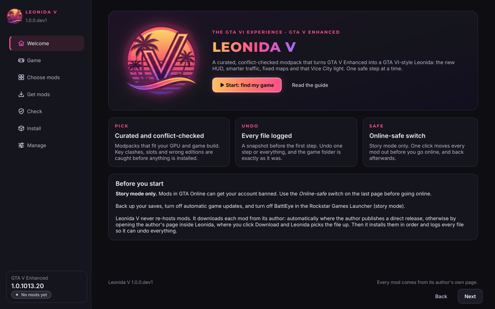
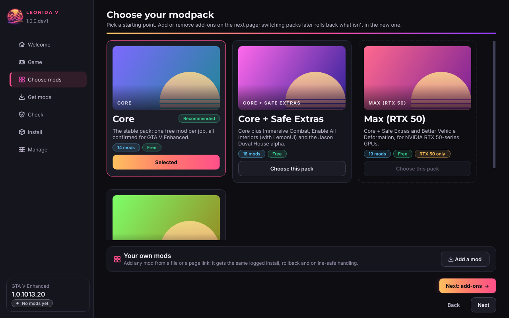
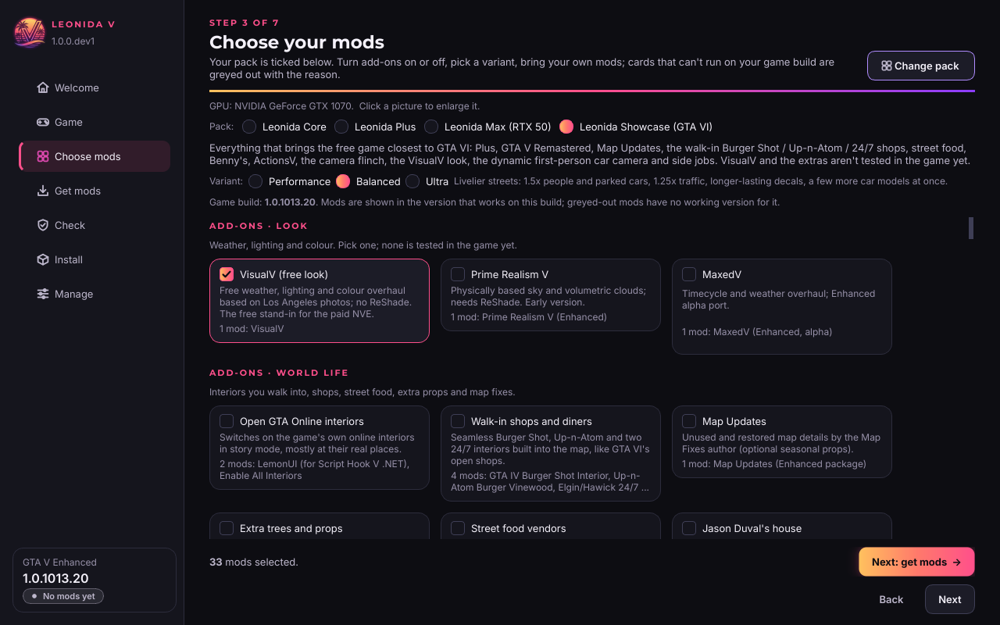
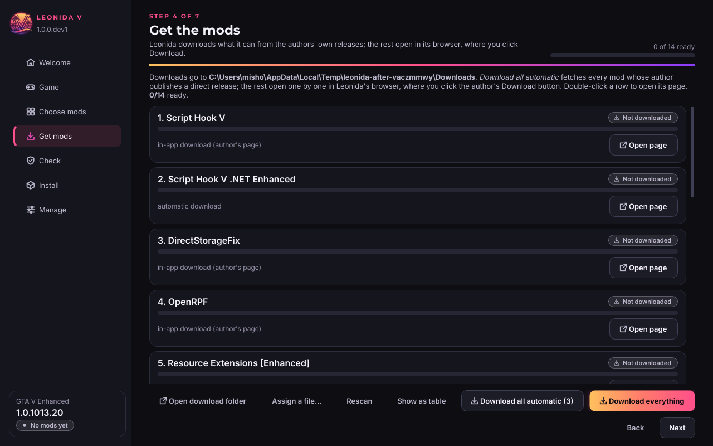
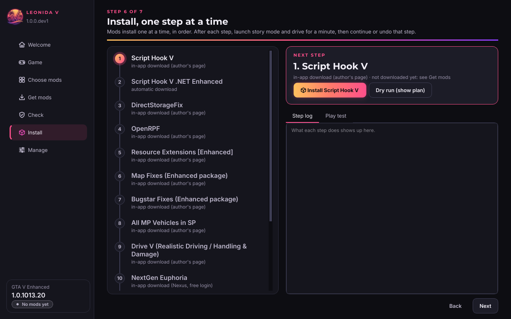
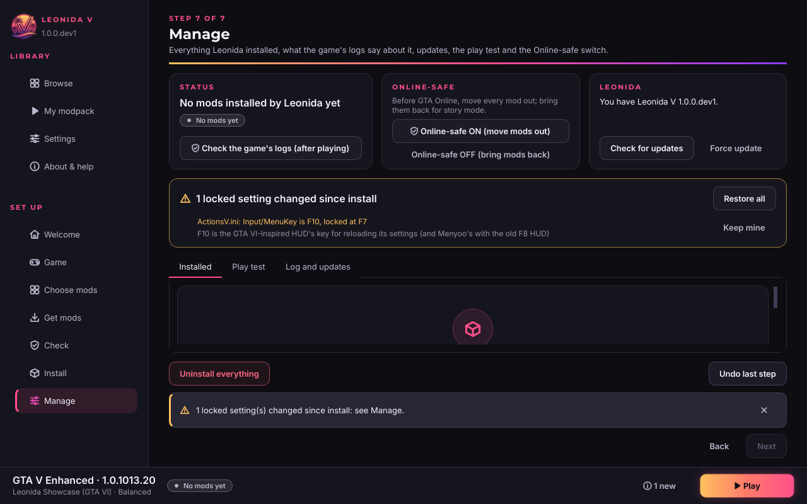

<p align="center">
  
</p>

# Leonida V

**A free GTA VI experience for GTA V Enhanced, installed for you, one safe step at a time.**

Leonida V is a launcher that sets up a curated, conflict-checked set of free mods: GTA VI's HUD and 3D minimap,
its wanted system and police, a GTA VI combat camera, heavier driving and physics, fuller streets, walk-in shops
and a new look. It downloads every mod from its own author, installs them in a tested order, locks the settings
that make them work together, and can undo every single file.

> **Story mode only.** Leonida never touches GTA Online. Before you go online, flip **Online-safe** on the *Manage*
> page: every mod moves out of the game folder, and back again afterwards.

Leonida V **never includes or re-hosts mod files**. Each mod comes from its author: a GitHub release or a direct
link the author publishes, otherwise the author's own page opens inside Leonida and it follows that site's own
Download button for you (you sign in where a site asks). New here? Read the step-by-step
[**guide**](docs/GUIDE.md).

## Screenshots

<table>
<tr>
<td width="50%"><br><sub><b>Welcome</b>: what Leonida does, in three promises: curated, every file logged, story mode only.</sub></td>
<td width="50%"><br><sub><b>Choose your modpack</b>: Core, Plus, Max (RTX 50) or the GTA VI Showcase, all free.</sub></td>
</tr>
<tr>
<td><br><sub><b>Add-ons and variants</b>: tick extras by category (Look, World life, Driving, ...) and pick Performance, Balanced or Ultra.</sub></td>
<td><br><sub><b>Get the mods</b>: <i>Download everything</i> fetches what it can and walks the authors' pages for the rest.</sub></td>
</tr>
<tr>
<td><br><sub><b>Install</b>: one mod per step, in order, with a dry run and a play test after each.</sub></td>
<td><br><sub><b>Manage</b>: status, Online-safe, updates, settings that changed since install, undo or uninstall everything.</sub></td>
</tr>
</table>

## The modpacks

| Pack | In one line | What you'll notice in game |
| --- | --- | --- |
| **Leonida Core** | The free, stable base: one mod per job. | GTA VI's HUD and 3D minimap, its wanted box and police lights; police that tase and arrest; a GTA VI aim camera; realistic driving and damage; more natural falls; online cars in traffic; fuel at the pump; straight into story mode. |
| **Leonida Plus** | Core plus the safe extras. | The game's own online interiors open in story mode, harder-hitting weapons, Jason's house; fuller streets on *Balanced* / *Ultra*. |
| **Leonida Showcase (GTA VI)** | Everything that brings the free game closest to GTA VI. | A warmer, more natural light and new weathers (VisualV), many more trees, GTA VI loading screens, modern phone icons, walk-in Burger Shot / Up-n-Atom / 24/7 shops, street food, Benny's, ActionsV, food-delivery and rideshare jobs, a first-person car camera. |

A fourth pack, **Leonida Max (RTX 50)**, adds Better Vehicle Deformation for RTX 50-series cards. Every pack has
**add-ons** you can tick (for example AuraV Lite path tracing on NVIDIA RTX cards), and **Plus** and **Showcase**
come in **Performance / Balanced / Ultra** (how full the streets are). What each pack covers of GTA VI, and what no
free mod can do yet, is in [`docs/GTA6-EXPERIENCE.md`](docs/GTA6-EXPERIENCE.md).

## Quick start


1. **Get Leonida**: from the [latest release](https://github.com/JacobJandon/leonida-v/releases/latest), either
   - **`Leonida-V-Setup-<version>.exe`** (recommended): installs it for your Windows user, with no administrator
     rights needed.
     - The program goes into `%LOCALAPPDATA%\Programs\Leonida V`.
     - Your data (State and Downloads) goes into a folder you pick (default `%LOCALAPPDATA%\Leonida V`).
     - It adds Start menu and desktop shortcuts, and an entry in Apps & features. Uninstalling asks before it
       touches your data, and never touches the game. Silent install: `/S [--dir D] [--data D]`.
   - `LeonidaV-<version>-win64.zip`: unzip it anywhere and start **`LeonidaV.exe`** (portable), or
   - the **portable kit**: put `Start-Leonida.bat` next to the source zip in a folder (for example `D:\Leonida`)
     and double-click **`Start-Leonida.bat`** (it sets up its own Python environment the first time).

   Leonida updates itself from these releases. It checks once a day, and nothing installs until you click
   **Update**. The new version's SHA-256 is checked before anything is switched over, and your State and
   Downloads stay. The zip and kit add a **Leonida V** shortcut the first time they run.
2. **Game**: it finds GTA V Enhanced and reads the game build.
3. **Choose mods**: pick a pack, tick add-ons, choose a variant.
4. **Get mods**: click **Download everything**. Sign in to Nexus Mods in Leonida's browser when it asks (free).
5. **Check**, then **Install**: one step at a time. After a step, the **Play test** starts story mode, reads the
   mods' logs and closes the game again.
6. Play. Before GTA Online: **Online-safe ON** on the *Manage* page.

Command line instead: `leonida.exe` (or `Leonida-CLI.bat`): `leonida get --auto --watch`, `leonida check`,
`leonida install`, `leonida playtest`. All commands: `leonida --help`.

## Requirements

- Windows 10 or 11, 64-bit.
- **GTA V Enhanced** (`GTA5_Enhanced.exe`, Steam, Epic or Rockstar Games Launcher). Leonida picks each mod's version
  for your game build; it was tested on **1.0.1013.20**. A separate, free mod list for **GTA V Legacy**
  (`GTA5.exe`) is included but hasn't been tried on a real Legacy game yet.
- .NET Framework 4.8 and the Visual C++ 2015-2022 runtime (x64): the *Check* page says if one is missing.
- A **free Nexus Mods account** for three mods (NextGen Euphoria in Core, Jason's house in Plus, Better Fist
  Fighting as an add-on).
- BattlEye switched off for story mode in the Rockstar Games Launcher's settings (Menyoo's page asks for it; Leonida
  doesn't touch anti-cheat).

## Honest limits

- **No Vice City or Leonida map.** The world stays Los Santos: no free, legitimate Vice City map exists for GTA V
  Enhanced.
- **NaturalVision Enhanced is paid** (Razed's Patreon). It's an optional add-on; the free look is VisualV.
- **GTA VI's own music, phone apps, cars and new movement** aren't there. Bring your own music for the HUD's
  On Demand radio.
- **Story mode only, never GTA Online.**
- Some mods were made on a newer game build and haven't been tried on every build yet; their cards say so.
- Files over 64 MB changed by a mod's *own* installer can't be backed up cheaply; rollback warns, and *Verify game
  files* restores them.

## How it keeps your game safe

- A **snapshot** of the game folder before the first step, and a **log** of every file added or replaced, with a
  backup of anything overwritten.
- Mods that change GTA's archives are installed into copies in **`mods\`**; the game's own files are never edited.
  Every change can be undone.
- **Undo** one step, or **uninstall everything** and get the snapshot back.
- **Checks** before installing: game build, two HUDs or cameras, key clashes, old limit adjusters, wrong-edition
  downloads, missing runtimes.
- **Locked settings**: the mods' settings that make them work together; *Manage* shows when one changed and puts it
  back, or keeps yours.

## Development

```powershell
pip install -e ".[dev,gui]"
pytest            # no game needed (fake game folders and archives); QT_QPA_PLATFORM=offscreen for the GUI tests
ruff check .
```

Windows exe and release assets: `pip install -e ".[dev,gui,build]"`, then `python build/build_exe.py --selftest`
(details in [`build/README.md`](build/README.md)). The mod list, packs, settings and hotkeys live in
[`leonida/manifest/`](leonida/manifest/). Roadmap: [`docs/PLAN.md`](docs/PLAN.md).

## Credits and licence

Leonida V's own code is MIT-licensed (see [`LICENSE`](LICENSE)). Every mod and tool belongs to its author and keeps
its own licence: see [**docs/CREDITS.md**](docs/CREDITS.md). Archive mods are installed with a small helper built
on your PC from **CodeWalker.Core** by dexyfex
([gta5-mods](https://www.gta5-mods.com/tools/codewalker-gtav-interactive-3d-map),
[source](https://github.com/dexyfex/CodeWalker)). Its source is "released for educational purposes only", and
Leonida never ships or re-hosts it. `.oiv` packages are read in OpenIV's package format (OpenIV Team). Not affiliated with Rockstar Games or Take-Two
Interactive. *Grand Theft Auto* is a trademark of Take-Two Interactive Software.
