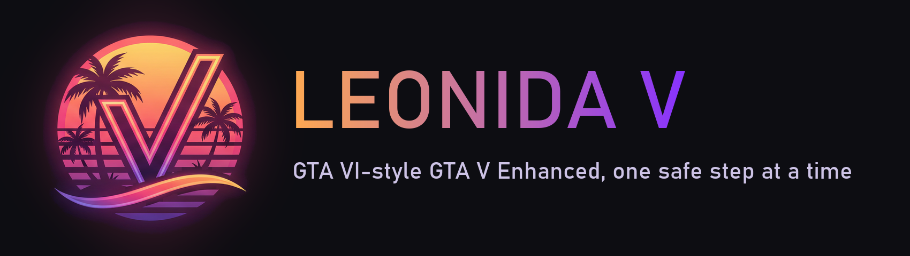

<p align="center">
  
</p>

# Leonida V

**A guided installer kit that turns GTA V Enhanced into a GTA VI-style experience.**
Next-gen lighting, a GTA VI HUD and radar, GTA VI combat camera, heavier physics and driving, denser traffic — installed in the right order, checked for conflicts, and fully undoable.

> **Story mode only.** Mods in GTA Online can get your account banned. Use `leonida online-safe on` (or the *Manage* page) before going online.

Leonida V **does not include or re-host any mod files.** It fetches each mod from its author: a GitHub release where the author publishes one, otherwise the author's own page opens inside the app and you click Download there. It recognises your downloads, installs them in a tested order, and logs every file it touches so it can roll anything back.

New here? The step-by-step guide is [`docs/GUIDE.md`](docs/GUIDE.md).

## What you get

| Layer | Mod (core profile) |
|---|---|
| Framework | Script Hook V · Script Hook V .NET Enhanced · DirectStorageFix · OpenRPF · Resource Extensions [Enhanced] |
| Graphics | none in Core (see below) |
| Fixes | Map Fixes · Bugstar Fixes |
| Traffic | All MP Vehicles in SP |
| Driving | Drive V (PermissionToLand) |
| Physics | NextGen Euphoria |
| Camera | GTA VI Combat Camera [Enhanced] |
| HUD | GTA VI-Inspired HUD by Geckomacabre (or the fbicat / "GTA VI Inspired Features" alternatives) |
| Tools | Menyoo 2.0 · Straight To Story Mode |

Profiles: **Core** (default) · **Core + Safe Extras** (Immersive Combat, Enable All Interiors, Jason Duval House) · **Max (RTX 50)** (adds Better Vehicle Deformation).
**Core is free.** Its only account is a free Nexus Mods login (for NextGen Euphoria). There's no graphics overhaul in Core: NaturalVision Enhanced needs Razed's paid Patreon Gold tier, so it's a paid add-on. The free graphics options, MaxedV (an alpha) and Prime Realism V (needs ReShade), are optional and share one *graphics* slot.
With NVE added, Leonida leaves OpenRPF out (NVE's `onigiri` loader replaces it), uses Drive V for NVE, and switches every affected mod's steps to `onigiri`.
The full list with versions, links, preview images, game-build ranges and install methods lives in [`leonida/manifest/mods.json`](leonida/manifest/mods.json).

## Screenshots

*Screenshots of the wizard are coming after the design pass.*

## Features

* **Wizard** (`LeonidaV.exe` / `leonida-gui`): Welcome → Game → Choose mods (preview pictures, profiles, extras, HUD choice) → Get mods → Check → Install → Manage.
* **Downloads from the author only**: automatic for GitHub releases and author-published direct links (**Download all automatic**); everything else in Leonida's **built-in browser** on the author's own page (gta5-mods.com, Nexus Mods with your own free login), where Leonida catches the file as you click Download. Patreon and Discord stay manual.
* **Any GTA V Enhanced build**: every mod says which game builds its versions support. Leonida reads your game's build and picks the matching release. Script Hook V was tested on **1.0.1013.20** (it runs as 1.0.1013.17); on builds before 1.0.1013.17 Leonida uses OpenRPF 0.2 instead of 0.3, and the paid NaturalVision Enhanced add-on gets its December 2025 release on 1.0.1013.20. A mod with no release for your build is reported with the reason instead of being installed. `leonida --game-build 1.0.1013.20 check` shows what any build would get.
* **Checks**: game build, old heap/packfile adjusters or `gameconfig.xml` next to Resource Extensions, two HUDs or two `cameras.ymt` mods, OpenRPF next to NVE, hotkey clashes, missing .NET 4.8 / VC++ runtimes, RTX 50 requirement.
* **Verify**: after a game start, `leonida verify` reads the mods' own logs (Script Hook V's `ScriptHookV.log` and `asiloader.log`, SHVDNE, Menyoo, ...) and says which installed mods really loaded, and whether Script Hook V supports your build.
* **Modpack and mod updates**: each Leonida release can carry a `modpack.json` with the exact mod files tested together (names, sizes, hashes and the authors' URLs; never the files). `leonida update` (or **Check for mod updates** on the *Manage* page) offers those tested versions for the mods you installed; `--check` only shows what would change, `--skip ID@VERSION` hides one.
* **Self-update**: `leonida self-update` (or **Check for updates** / **Update Leonida** on the *Manage* page) updates Leonida itself from its GitHub releases, checked against `SHA256SUMS.txt`; `--check` only looks.

## Install


Requires Windows and GTA V Enhanced.

**Windows app:** download `LeonidaV-<version>-win64.zip` from the GitHub release, unzip it anywhere and start **`LeonidaV.exe`** (the wizard) or `leonida.exe` (the command line). Nothing else to install.

**Portable folder (64-bit Python 3.10+):** put `Start-Leonida.bat`, `Leonida-CLI.bat` and `leonida-v-<version>.zip` in one folder (for example `D:\Leonida`) and double-click `Start-Leonida.bat`.
It unpacks the project, creates a private Python environment, installs everything on first run and opens the wizard.
Mod downloads go to `<folder>\Downloads`, settings, logs and backups to `<folder>\State`. `Leonida-CLI.bat` opens the command line with the same folders.

**Or with pip:**

```powershell
pip install "leonida-v[gui] @ git+https://github.com/JacobJandon/leonida-v"
leonida-gui                  # the wizard
# or the command line:
leonida detect               # find the game
leonida get --auto --watch   # download what can be downloaded, open the other pages, track the downloads
leonida check                # game build, leftovers, HUD/camera clashes, hotkeys, prerequisites
leonida install              # one mod at a time, with a test pause after each
leonida verify               # after starting the game: which mods really loaded
```

## Safety model

* **Baseline snapshot** of the game folder before the first step.
* **Install log** (in the state folder: `<folder>\State` for the portable kit, otherwise `%LOCALAPPDATA%\LeonidaV`): every file added or replaced, with its hash and a backup of anything overwritten.
* **Four install methods**: `copy` (only the named files), `generic` (shows the proposed files and asks first), `run` (the mod's own installer, changes recorded), `guided` (step-by-step instructions, changes recorded).
* **Rollback** any step (`leonida rollback`), or **uninstall** everything (`leonida uninstall`) and compare with the snapshot.
* **Online-safe switch** moves every mod file into `_LeonidaV_offline` and back.

Known limit: files larger than 64 MB changed by a mod's *own* installer (for example inside `mods\update\update.rpf`) cannot be backed up cheaply; rollback warns and you restore them with *Verify game files*.

## Commands

```
leonida detect [--set PATH]           find / set the game folder
leonida profiles [--use PROFILE]      list or choose a profile
leonida swap hud-geckomacabre hud-fbicat   pick an alternative for a slot
leonida get [--auto] [--watch] [--no-open]   download, open pages, track downloads, write the lockfile
leonida assign FILE MOD               tell Leonida what an unrecognised file is
leonida check                         run every check
leonida install [--dry-run] [--only MOD ...] [--yes] [--no-pause] [--force]
leonida verify [--lines]              read the mods' logs after a game start
leonida status                        settings, steps, mods on/off
leonida rollback [STEP]               undo one step (default: the last)
leonida uninstall                     undo everything
leonida online-safe on|off|status     move mods out / back
leonida keys [set MOD ACTION KEY]     hotkeys and clashes
leonida doctor                        GPU, prerequisites, 7-Zip
leonida update [--check] [--mod ID] [--skip ID@VERSION] [--modpack FILE] [--yes]   tested mod updates
leonida modpack build                 record the matched downloads as the tested set (maintainers)
leonida self-update [--check]         update Leonida V itself
leonida --game-build 1.0.1013.20 check   treat the game as another build (testing)
```

## Development

```powershell
pip install -e ".[dev,gui]"
pytest            # no game needed (fake game folders and archives); QT_QPA_PLATFORM=offscreen for the GUI tests
ruff check .
```

**Windows exe and release assets:** `pip install -e ".[dev,gui,build]"`, then `python build/build_exe.py --selftest` builds `dist/LeonidaV/` (`LeonidaV.exe`, `leonida.exe`) and starts it once in self-test mode; `--release` also writes the release zips, `modpack.json` and `SHA256SUMS.txt`. Details in [`build/README.md`](build/README.md).

**Logo and icons:** the logo is concept 02 (*Sunset Emblem*) from `assets/logo-concepts.png`. After changing it, run `python assets/make_icons.py` (needs Pillow, dev only) to regenerate `assets/leonida-logo.png`, `assets/leonida-banner.png` and the app icons in `leonida/gui/assets/` (`leonida.png`, `leonida.ico`).

Project plan, architecture and roadmap: see `docs/`.

## Credits and licence

The kit's code is MIT-licensed (see `LICENSE`). Every mod belongs to its author and keeps its own licence. See [`docs/CREDITS.md`](docs/CREDITS.md). Not affiliated with Rockstar Games or Take-Two Interactive.
