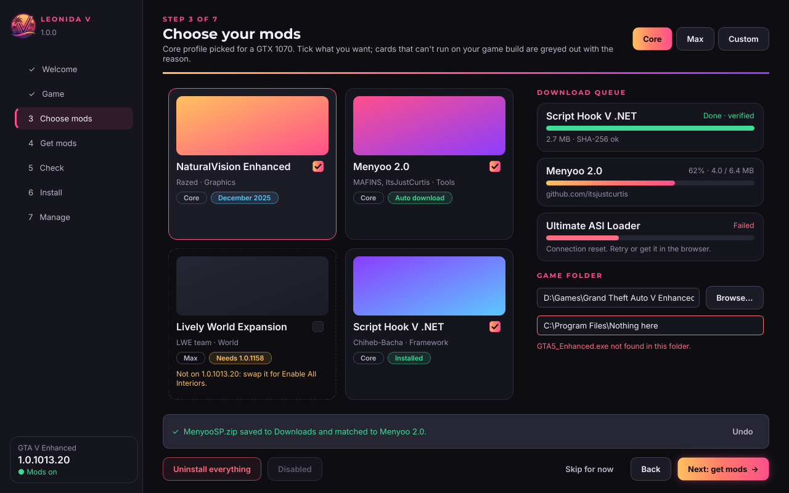
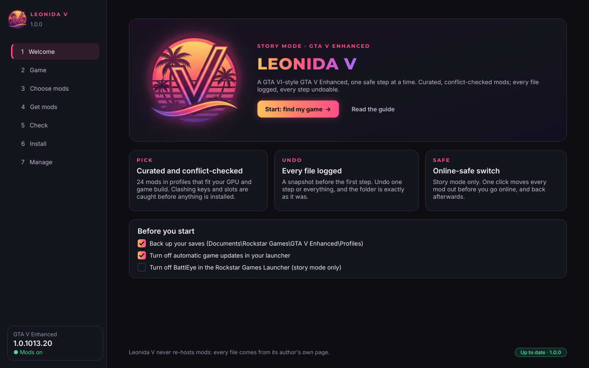

# Leonida V design: "Sunset Emblem"

The look follows the chosen logo, 02 Sunset Emblem (`leonida/gui/assets/leonida.png`, `assets/leonida-banner.png`).
A sunset runs gold → coral → violet over near-black, with a neon glow and palm silhouettes: Vice City / GTA VI at
night. The UI keeps the colour to a few accents (primary action, selection, progress, the brand strip). Everything
else is calm dark surfaces, so the mod art and the logo carry the mood.

- **Code:** `leonida/gui/theme.py` holds the tokens, `build_qss()`, `palette()`, `apply_theme(app)`, `add_glow()`,
  `gradient_label()` and `repolish()`.
- **Fonts:** `leonida/gui/assets/fonts/`.
- **Previews:** `docs/design/theme-preview.png` (Choose mods) and `docs/design/theme-preview-welcome.png` (Welcome).
  Re-render them with `QT_QPA_PLATFORM=offscreen python build/theme_preview.py [--page welcome]`.




## 1. Tokens

### Colour (dark theme first)

| Token | Hex | Use |
|---|---|---|
| `bg` | `#0D0D12` | window background (the logo's backdrop) |
| `surface` | `#15151D` | sidebar, cards, inputs, lists |
| `surface_2` | `#1C1C27` | hovered card, secondary buttons, table header |
| `surface_3` | `#262634` | selected rows, badges, toasts, progress track |
| `border` / `border_strong` | `#2C2C3C` / `#3E3E55` | 1 px outlines; strong for inputs and buttons |
| `text` | `#F4F1FA` | primary text |
| `text_muted` | `#BDB7CC` | body copy, secondary labels |
| `text_subtle` | `#9690A8` | captions, metadata, placeholders |
| `text_disabled` | `#5E596E` | disabled controls (exempt from AA, still ≥ 2:1) |
| `text_on_accent` | `#0D0D12` | text on the gold → coral primary gradient |
| `gold` / `coral` / `violet` | `#FFC15E` / `#FF4F8B` / `#8B3DFF` | brand: gradients, selection marker, eyebrows |
| `violet_text` / `focus` | `#B08CFF` | links, focus ring (pure violet is too dark for text) |
| `success` / `warning` / `error` / `info` | `#3DDC97` / `#FFC15E` / `#FF6B81` / `#5CC8FF` | status text, badges, progress tones |

Gradients:
- **`GRADIENT`** (gold → coral, `#FFC15E → #FF7A6B → #FF4F8B`) is used for primary buttons, progress chunks and
  checked boxes.
- **`GRADIENT_FULL`** (gold → coral → violet) is reserved for brand moments: the 3 px strip under page headers and the
  hero wordmark.

**Contrast (WCAG 2.x AA, 4.5:1 for normal text):**
- `text`, `text_muted`, `text_subtle`, `violet_text`, `gold`, `coral` and all four status colours are checked against
  `bg`, `surface` and `surface_2`.
- `text` and `text_muted` are also checked against `surface_3`.
- `text_on_accent` is checked against every stop of the primary gradient.
- `tests/test_theme.py` enforces this, using `theme.CONTRAST_PAIRS`. The weakest pair, `text_subtle` on `surface_2`,
  is still above 5:1.
- Never put white text on the gradient (coral fails at 3:1); dark text on it passes at 6.5:1 and above.

### Typography

| Role | Font | Size (pt) | Weight |
|---|---|---|---|
| `display` (hero wordmark) | Montserrat | 26 | ExtraBold, +1 px tracking, `gradient_label()` |
| `title` (page title) | Montserrat | 17 | Bold |
| `eyebrow` (STEP 3 OF 7, section labels) | Montserrat | 8 | Bold, caps, +2 px tracking, coral |
| `subtitle` (card / row names) | Inter | 12 | SemiBold |
| body | Inter | 10 | Regular |
| `caption` (metadata) | Inter | 9 | Regular, `text_subtle` |
| `badge` | Inter | 8 | SemiBold |
| log view | Cascadia Mono / Consolas | 9 | Regular |

Fonts are bundled and loaded by `theme.load_fonts()`, with a fallback to Segoe UI:
- **Inter 4.1** (Regular, Medium, SemiBold, Bold) by The Inter Project Authors, SIL OFL 1.1.
- **Montserrat** (SemiBold, Bold, ExtraBold) by The Montserrat Project Authors, SIL OFL 1.1.

The licences ship next to the font files, and the fonts are credited in `docs/CREDITS.md`.

### Spacing, radius, elevation

- **Spacing:** `SPACE` = 2 · 4 · 8 · 12 · 16 · 24 · 32 · 48 px.
  - Page padding is 32/24 (Welcome 48/40).
  - Gap between cards is 14.
  - Card inner padding is 12–16.
- **Radius:** `RADIUS` = sm 6 (inputs, tooltips) · md 10 (buttons, list rows, toasts) · lg 14 (cards) · pill 999
  (badges are 9).
- **Elevation:** no drop shadows on surfaces; depth comes from the surface steps. Glow (`add_glow`, coral at 45–55%)
  is used only for the hero logo and the one primary call to action on a page.

### Component states

| Component | Default | Hover | Pressed / active | Focus | Disabled | Other |
|---|---|---|---|---|---|---|
| Button `primary` | gold→coral gradient, dark bold text | lighter gradient | darker gradient | 1 px `text` outline | `surface_3`, disabled text | one per page, glow allowed |
| Button `secondary` (default) | `surface_2`, strong border | `surface_3`, violet border | `surface` | violet border | `surface`, disabled text | |
| Button `ghost` | transparent, muted text | `surface_2`, `text` | | | | tertiary: Skip, Read the guide |
| Button `danger` | error text, 8% error fill | 18% fill, error border | | | | Uninstall, Undo all |
| Input (line edit, combo) | `surface`, strong border | subtle border | | violet border | disabled text | `invalid=true` gives an error border plus an error caption below |
| Checkbox | `surface`, strong border | violet border | | | `surface_2` | checked: gradient fill, dark tick (`assets/icons/check.svg`) |
| List / table row | transparent | `surface_2` | | | disabled text | selected: `surface_3` |
| Card (`card=true`) | `surface`, `border`, r14 | `surface_2`, strong border | | | `disabled=true`: `bg`, dashed border | `selected=true`: coral border; `tone=error/warning/success`: tinted border |
| Progress bar | `surface_3` track, 8 px, gradient chunk | | | | | `tone=success/error` gives a solid chunk; `thick=true` (18 px) shows the % text |
| Nav item (`#nav`) | muted text, r10 | `surface_2`, `text` | | | disabled text | current: coral 12% fill, 3 px coral left bar, bold |
| Badge (`role=badge`) | `surface_3`, muted | | | | | `tone=*` gives a 12% tint and a 45% border in that colour |
| Toast (`toast=true`) | `surface_3`, strong border, r10 | | | | | status icon and text in the tone colour, optional ghost action |
| Dialog | `surface` background, palette-driven | | | | | buttons min 84 px; primary on the right |

## 2. UX rules for every page

- **One primary action per page,** bottom right (Next / Install / Start). Secondary actions sit to its left (Back),
  tertiary ones are ghost (Skip). Destructive actions are `danger`, bottom left, and always confirmed.
- **Header pattern:**
  1. an eyebrow `STEP n OF 7`;
  2. a `title`;
  3. one `muted` sentence that says what to do;
  4. the brand strip.
  The right side of the header holds page-level switches (profiles, filters).
- **Sidebar:**
  - Steps are numbered.
  - Finished steps show ✓.
  - Steps that can't be reached yet are disabled with a tooltip saying why ("Pick the game folder first").
  - The bottom card shows the game build and the Mods on / Online-safe state, so it is visible on every page.
- **Busy pattern:** never block the window.
  - Long work runs on a worker. The control that started it turns into its progress (the button becomes disabled
    "Downloading… 3 of 7", and a per-row progress bar appears). Cancel sits next to it as a ghost button.
  - The sidebar stays clickable; a page that is busy shows a small coral dot on its nav item.
- **Status messages:**
  - **Toast:** a short result toast above the action bar (success, info). It disappears after 6 s, or stays until
    closed when it has an action ("Undo", "Open folder").
  - **Error:** an error toast stays until it is closed and names the next step.
  - **Status bar:** long-lived status ("Checking for updates…") goes in the status bar.
- **Empty states:** a centred caption, one sentence, and one button that fixes it.
  - "No downloads yet. Get mods →"
  - "Nothing installed yet. Go to Install →"
- **Error states:** the reason in plain words plus what to do, on the item itself (red caption under an input, a red
  border and an error line on a card or row). There is never a modal for something that can be shown inline. Modals
  are for confirmations (install, uninstall, online-safe) and for things that need an answer.
- **Copy:** sentence case, second person, no jargon in the first line. Technical detail (file names, log lines) goes
  in captions or behind "Details".

## 3. Pages

### Welcome: hero with logo

Primary: **Start: find my game**. Secondary (ghost): Read the guide.

```
┌ sidebar ─────┐┌──────────────────────────────────────────────────────────────────────┐
│ (logo) LEONIDA V ││ ╭─ hero (r18, faint sunset gradient) ───────────────────────────────╮ │
│ 1.0.0        ││ │  [ LOGO 210px, coral glow ]   STORY MODE · GTA V ENHANCED (eyebrow)  │ │
│              ││ │                               LEONIDA V  (gradient wordmark)         │ │
│ ▌1 Welcome   ││ │                               One sentence pitch (muted)             │ │
│  2 Game      ││ │                               [Start: find my game →]  Read the guide │ │
│  3 Choose    ││ ╰───────────────────────────────────────────────────────────────────╯ │
│  4 Get mods  ││ ┌ PICK ─────────────┐ ┌ UNDO ─────────────┐ ┌ SAFE ─────────────┐      │
│  5 Check     ││ │Curated & checked  │ │Every file logged  │ │Online-safe switch │      │
│  6 Install   ││ └───────────────────┘ └───────────────────┘ └───────────────────┘      │
│  7 Manage    ││ ┌ Before you start ─────────────────────────────────────────────────┐ │
│              ││ │ ☑ Back up saves  ☑ Auto-updates off  ☐ BattlEye off (story mode)  │ │
│ ┌ game card ┐││ └───────────────────────────────────────────────────────────────────┘ │
│ │1.0.1013.20│││ never re-hosts mods (caption)                       (Up to date) badge │
└──────────────┘└──────────────────────────────────────────────────────────────────────┘
```

- **Empty / error:** a self-update available shows an info toast, "Leonida V 1.1 is out: Update". An update check
  that fails stays silent (status bar only).

### Game

Primary: **Use this folder**. Secondary: Browse…, Detect again.

```
STEP 2 OF 7 · Find GTA V Enhanced
┌ Detected ──────────────────────────────────────────────────────────────┐
│ ◉ D:\Games\Grand Theft Auto V Enhanced      Steam? no · Common path    │
│   GTA5_Enhanced.exe 1.0.1013.20   (Tested build)/(Not tested) badge    │
│ ○ C:\Program Files\Rockstar Games\...      Rockstar                    │
└────────────────────────────────────────────────────────────────────────┘
[ D:\Games\Grand Theft Auto V Enhanced          ] [Browse…]
caption: build, store, prerequisites (.NET 4.8 ✓, VC++ ✓, 7-Zip –)
                                              [Back]  [Use this folder →]
```

- **Empty:** "No GTA V Enhanced found. Browse to the folder with GTA5_Enhanced.exe." The input is focused.
- **Error:** the input gets `invalid=true` and the caption "GTA5_Enhanced.exe not found in this folder."
- A build newer than tested gets a warning card; an untested older build gets an info card that links the
  "does it run?" guide section.

### Choose mods: card grid

Primary: **Next: get mods**. The header right holds the profile switch (Core · Max · Custom).

```
STEP 3 OF 7 · Choose your mods                         [Core][Max][Custom]
━━━━━━━━━━━━━━━━━━━━━━━━ brand strip ━━━━━━━━━━━━━━━━━━━━━━━━━━━━━━━━━━━━
Filter: (All)(Framework)(Graphics)(World)(Tools)          ⌕ search
┌ card ──────────┐ ┌ card ──────────┐ ┌ card ──────────┐ ┌ card (dashed) ─┐
│ [ preview art ]│ │ [ preview art ]│ │ [ preview art ]│ │ [ grey art ]   │
│ Name        ☑  │ │ Name        ☑  │ │ Name        ☐  │ │ Name        ☐  │
│ author · layer │ │ author · layer │ │ author · layer │ │ author · layer │
│ (Core)(Auto)   │ │ (Core)(Dec 25) │ │ (Max)          │ │ (Needs 1158)   │
│                │ │                │ │ slot: HUD ⇄    │ │ why + swap link│
└────────────────┘ └────────────────┘ └────────────────┘ └────────────────┘
summary bar: 14 mods · 3 auto downloads · 1 hand-made step      [Back] [Next →]
```

- **Cards:**
  - A selected card has a coral border.
  - Slot alternatives show a ⇄ link that opens a small chooser.
  - An unsupported card is dashed, its checkbox disabled, with the reason and a swap suggestion in a warning caption.
  - "How to install" opens a side sheet.
- **Empty:** a filter with no matches shows "No mods match. Clear filters".

### Get mods: download queue

Primary: **Download all** (it becomes **Next: check** when everything is matched). Secondary: Get the rest in
Leonida's browser, Open downloads folder.

```
STEP 4 OF 7 · Get the mods                    7 of 14 ready  ▓▓▓▓▓▓░░░░░░
┌ Script Hook V .NET ─────────────── Done · verified ┐
│ ████████████████████████████████████ (success)      │  2.7 MB · SHA-256 ok
├ Menyoo 2.0 ───────────────────── 62% · 4.0/6.4 MB ┤
│ ██████████████████████░░░░░░░░░░░░░ (gradient)     │  [Cancel]
├ NaturalVision Enhanced ─────────── Get in browser ┤
│ caption: razedmods.com — click Download on the page │  [Open page]
├ Ultimate ASI Loader ───────────────────── Failed ┤
│ ███████░░░░░░░░░░░░ (error)  Connection reset       │  [Retry] [Browser]
└─────────────────────────────────────────────────────┘
toast: ✓ MenyooSP.zip saved and matched to Menyoo 2.0          [Show]
                      [Open downloads folder] [Get the rest in browser] [Download all]
```

- Each row is a mod, never a file. Its status text names the action ("Get in browser", "Assign file…").
- A file that doesn't match shows "Which mod is this?" inline, with a combo box.
- The browser window uses the same theme. Its header shows the current mod, a "Next mod" primary button, and a
  coral progress line for the active download.

### Check

Primary: **Next: install** (disabled while there are errors). Secondary: Re-run checks.

```
STEP 5 OF 7 · Check before installing
(✓ 18 passed)  (⚠ 2 warnings)  (✕ 1 error)        ← tone badges, clickable filters
┌ ✕ error card ─────────────────────────────────────────────┐
│ Lively World Expansion can't run on 1.0.1013.20            │
│ caption: needs 1.0.1158.13 or newer                         │
│                                   [Swap for Enable All Interiors] │
├ ⚠ warning card ───────────────────────────────────────────┤
│ F8 is used by Menyoo and the HUD settings menu  [Change key…]│
└────────────────────────────────────────────────────────────┘
```

- Each finding is a card tinted by tone, with the fix as a button on the card itself.
- **Empty:** a success state with a large ✓ and "Everything checks out. Next: install →".

### Install: stepper with test prompts

Primary: **Install step n** (it becomes **I tested it, continue**, then **Finish**). Secondary: Pause, Undo this
step (danger, ghost-sized).

```
STEP 6 OF 7 · Install, one step at a time
 ●───●───◉───○───○───○───○      ← stepper (done ● / current ◉ coral glow / next ○)
 SHV  .NET Menyoo NVE …
┌ current step card ───────────────────────────────────────────────┐
│ Menyoo 2.0 · copy · 49 files                                     │
│ ▓▓▓▓▓▓▓▓▓▓▓▓▓▓▓▓▓▓░░░░ (thick, % text)                           │
│ ▸ Details: files placed (log view, monospace, collapsed)         │
└──────────────────────────────────────────────────────────────────┘
┌ test prompt (info card) ─────────────────────────────────────────┐
│ Start the game to story mode. Press F8: does Menyoo open?        │
│ [Launch game]  [It works → continue]  [It doesn't → undo step]   │
└──────────────────────────────────────────────────────────────────┘
```

- Guided steps show a numbered checklist with "Open folder" and "Open page" buttons, and **Done** as primary.
- After a game start, the step card shows the verify results inline: an OK badge, or a FAILED badge with the log
  line in a caption.
- **Error:** the step card turns `tone=error`, shows "Undo this step" as the primary action and the log line
  underneath.

### Manage

Primary depends on the state: **Check my mods** (verify), **Update mods**, or **Update Leonida**. Danger: Uninstall
everything.

```
STEP 7 OF 7 · Manage
┌ Status ─────────────────┐ ┌ Online-safe ──────────────┐ ┌ Leonida ───────────────┐
│ 14 mods · Mods ON       │ │ ( ● Mods on | Online-safe )│ │ 1.0.0 · Up to date      │
│ game 1.0.1013.20        │ │ moves 23 files out/back   │ │ [Check] [Force update]  │
└─────────────────────────┘ └───────────────────────────┘ └─────────────────────────┘
Tabs: [Installed] [Log check] [Updates] [History]
 Installed: rows  name · version · step # · (OK)/(FAILED)/(not seen) badge · [Undo]
 Log check: verify results grouped per mod; failed rows show the log line
 Updates:   modpack diff rows (update/download/get/refused) + [Skip this version]
 History:   install log (monospace)                                   [Uninstall everything]
```

- **Empty:** "Nothing installed yet. Go to Install →".

## 4. Wiring it in (for the GUI owner)

- **Start-up:** call `theme.apply_theme(app)` in `main()` after the QApplication exists and before `MainWindow()`.
  It returns the body and display family names.
- **Names and properties:**
  - the sidebar list: `setObjectName("nav")`, inside a container named `sidebar` (`WA_StyledBackground`);
  - buttons: `setProperty("variant", "primary" | "secondary" | "ghost" | "danger")`;
  - cards: `QFrame` with `card=True`, plus `selected`, `disabled` or `tone`;
  - labels: `role` and `tone`;
  - progress bars: `tone` or `thick`;
  - invalid inputs: `invalid=True`.
- After changing a property at runtime, call `theme.repolish(widget)`.
- **Hero:** use `theme.gradient_label("LEONIDA V")` for the wordmark, and `theme.add_glow()` on the logo and on the
  page's one primary button.
- **Frozen build:** `build/leonida.spec` bundles `leonida/gui/assets/**` (logo, icons, fonts).
